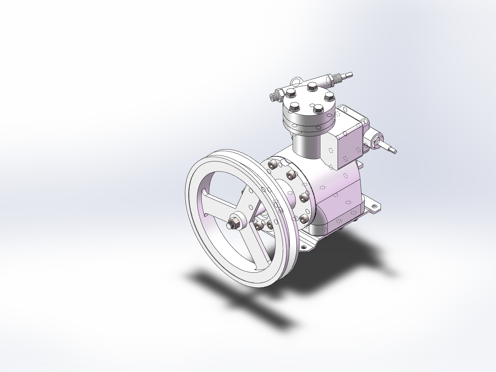

# SolidWorks 压缩机三维建模与装配

**从工程图纸到机械装配：一个压缩机 CAD 建模实践项目。**

[English](docs/README.en.md) · [打开模型](docs/CAD_GUIDE.md) · [零件与装配清单](docs/PARTS.md) · [检查记录](docs/VALIDATION.md)



> 上图由本仓库装配体在 SolidWorks 中直接导出。模型用于展示机械识图、零件建模与装配实践；图纸来源、文件检查结果和使用授权见下文。

## 项目背景

本项目根据《2024年河南省工业软件创新大赛压缩机》图纸进行三维建模，保留 SolidWorks 原生零件与装配文件，便于查看零件结构、研究装配关系和回顾建模过程。

压缩机通过带轮驱动曲轴，借助拨叉带动活塞往复运动，配合进排气结构完成吸气、压缩和排气。仓库包含泵体、曲轴、活塞、拨叉、带轮、阀板、进出气盖，以及密封、连接和标准紧固件等模型。

## 内容概览

| 内容 | 当前交付 |
| --- | --- |
| 原生零件 | 34 个 `.SLDPRT` / `.sldprt` 文件，其中 28 个来自初始工作区，6 个为补齐的原装配依赖 |
| 原生装配体 | [`装配体1.SLDASM`](装配体1.SLDASM)，默认配置中读出 78 个组件实例 |
| 参考图纸 | 1 份、共 7 页，保留原始 PDF |
| 浏览预览 | 本地 PNG 装配视图，无需安装 CAD 软件即可查看 |
| 配套文档 | 打开指南、零件清单、图纸索引、检查记录与发布说明 |
| 文件校验 | 标准库 Python 脚本、SHA-256 文件清单与 GitHub Actions 检查 |

**核查环境：SolidWorks 2020 SP1（API 修订号 28.1.0）。** 34 个依赖文件已在仓库中补齐，默认配置可只读打开，所有 78 个组件均为完全解析状态。模型的重建情况和检查边界见[检查记录](docs/VALIDATION.md)。

## 快速开始

1. 克隆仓库，或下载并完整解压 ZIP。请保留所有原生模型文件，不要只下载装配体。
2. 在 SolidWorks 中打开根目录下的 [`装配体1.SLDASM`](装配体1.SLDASM)。本项目已在 2020 SP1 环境读取验证；其他版本请自行确认兼容性。
3. 如提示查找文件，将搜索位置指向当前仓库根目录。所有零件采用原文件名，和装配体放在同一层。
4. 检查默认配置，并执行一次重建。需要编辑时，建议先保存一份个人副本。

具体操作与常见问题见[模型使用指南](docs/CAD_GUIDE.md)。

## 建模内容与阅读路线

- **主体与接口**：从泵体入手，观察主腔、连接法兰、端盖与安装底板的结构组织。
- **运动零件**：结合曲轴、拨叉、转销和活塞，理解旋转运动与往复运动的联系。
- **气路与密封**：查看进气盖、出气盖、阀板、控制杆、气管接头及各类垫片。
- **整机装配**：从零件模型进入装配体，查看组件配置、定位关系和标准件布置。

这是一份已有建模成果的整理归档。文档描述实际文件与图纸内容，没有将建议的建模方法写成未经核实的原始操作记录，也没有附加仿真、获奖或制造验证结论。

## 仓库结构

```text
.
├── 装配体1.SLDASM              # 原生装配入口
├── *.SLDPRT / *.sldprt         # 自制零件及补齐的标准件，共 34 个
├── 2024年河南省工业软件创新大赛压缩机.pdf
├── docs/
│   ├── images/                # 真实模型预览
│   ├── CAD_GUIDE.md            # 打开、重建与导出说明
│   ├── PARTS.md                # 文件分类与实际装配数量
│   ├── REFERENCES.md           # 图纸页码及来源说明
│   ├── VALIDATION.md           # 检查结果与适用范围
│   ├── PUBLISHING.md           # 仓库名称、简介与上传步骤
│   ├── model-manifest.json     # 模型及参考资料的哈希清单
│   └── assembly-components.csv # 实际组件实例与配置
├── scripts/check_repository.py
├── .github/                   # 自动检查与问题反馈模板
├── .gitattributes             # CAD/PDF 按二进制管理
├── .gitignore                 # 忽略锁文件、恢复文件及本地缓存
├── CONTRIBUTING.md
├── LICENSE
└── THIRD_PARTY_NOTICES.md
```

模型保留在根目录，便于装配体按原文件名查找零件。图纸序号、零件文件数和组件实例数含义不同，详见[零件清单](docs/PARTS.md)。

## 文件完整性检查

在仓库根目录使用 Python 3.10 或更高版本运行，无需安装第三方依赖：

```powershell
python scripts/check_repository.py
```

该检查验证文件存在性、SHA-256、组件文件与文档链接。它不调用 SolidWorks，也不替代配合、干涉或尺寸检查。修改模型后应同步更新清单中的文件大小与哈希，并在检查记录中说明变更。

## 交付边界

- 当前保留原生模型和原始参考图纸，未提供独立的 `.SLDDRW` / `.dwg` 二维工程图或运动动画。
- 本次文件整理保留原始 30 个文件的内容，并补齐 6 个原装配依赖；不代表完成了原比赛全部格式、命名和工程图要求。
- 装配模型的标准件配置与图纸要求尚未逐项做一致性验收；当前实际配置与数量已单独列出。
- 尚未进行完整尺寸复核、干涉检查、强度分析、热力学计算、工艺与样机验证。

## 版权与来源

按作者当前选择，原创模型与原创整理内容**保留全部权利，暂不授予额外使用许可**；公开展示不等于开放授权。详见 [LICENSE](LICENSE)。

比赛图纸和标准件保留各自权利归属，不适用原创部分的版权声明。来源说明见 [THIRD_PARTY_NOTICES.md](THIRD_PARTY_NOTICES.md) 与[图纸索引](docs/REFERENCES.md)。

欢迎通过 Issue 反馈文件缺失、打开问题、图纸对应问题或文档错误。提交模型修改前，请先阅读[协作说明](CONTRIBUTING.md)。
